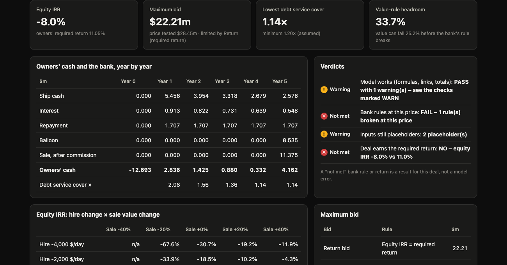

# Yan Li · Shipping valuation and investment

PhD in finance (dry bulk trade networks, freight price discovery) · 14 years as an analyst in dry bulk shipping and ship finance.

This portfolio follows one question from start to finish: **what is a ship worth, and should we buy it at this price?**
It has three parts, in the order the work happens.

---

## 1 · Automation: broker reports to a sales database

Weekly broker reports are read, checked by me, and stored as a clean database of ship sales (593 sales so far).
Each step is a small project with its own code, tests and documents.

  

Code: [sales-register](https://github.com/YLI2018/sales-register)

---

## 2 · Valuation: what the ship is worth

Each ship is valued from comparable sales, using only sales reported before the valuation date (no hindsight).
Example: a 14-year-old MR product tanker is worth **$29.7m**, from 43 comparable sales (range $26.3m to $33.1m).

Code and method: [shipping-vessel-valuation](https://github.com/YLI2018/shipping-vessel-valuation)

---

## 3 · Investment decision: the most we should pay

The same ship as a purchase: time charter income, a 60% bank loan, and a sale after 5 years.
At the asking price of $28.45m the deal earns -8.0% for the owners, against an 11.05% required return.
The model works out the **maximum bid: $22.2m**. That is the highest price that meets the required return and both bank tests (minimum ship value and debt service cover).

Method: [M3 acquisition and finance](https://github.com/YLI2018/shipping-vessel-valuation/blob/main/docs/methodology/m3_acquisition.md)

---

Ship names in the pictures are anonymised. Values are model outputs from a personal portfolio project, not investment advice.
