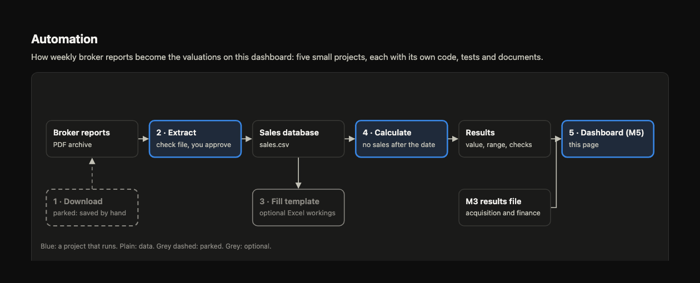
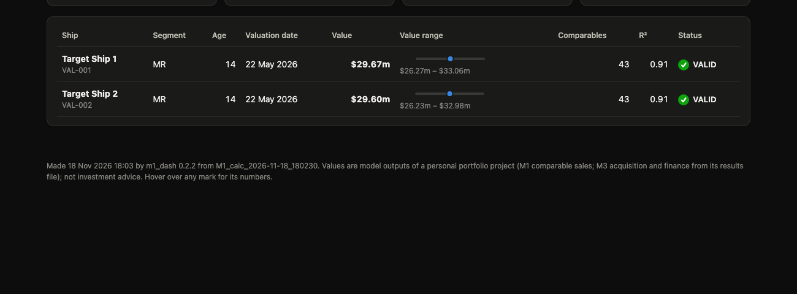
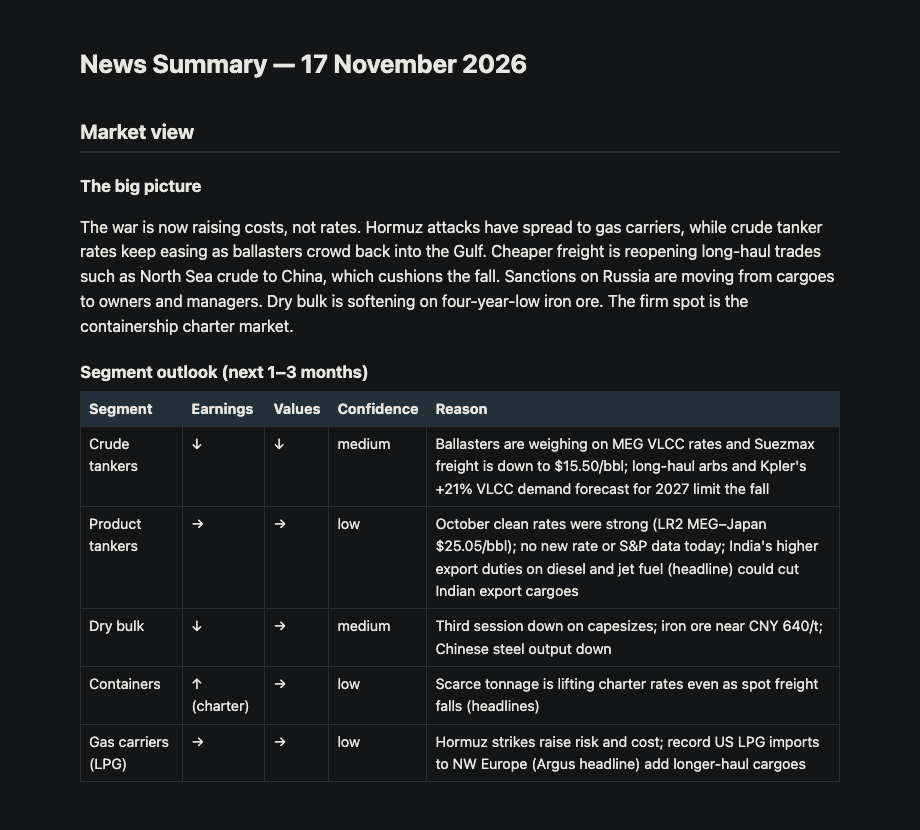

# Yan Li · Shipping valuation and investment

PhD in finance (dry bulk trade networks, freight price discovery), with experience across energy markets, trading, regulatory economics and insurance risk.

Published research: [Trade dynamics of the global dry bulk shipping network](https://doi.org/10.1016/j.tre.2025.104597), Transportation Research Part E (2026).

Contact: [LinkedIn](https://www.linkedin.com/in/yan-li-649b5a33/) · [yanli.kaapa@gmail.com](mailto:yanli.kaapa@gmail.com)

This portfolio answers one question: **what is a ship worth, and should we buy it at this price?**
Three steps answer it: build a database of ship sales, value the ship, then set the most we should pay. Alongside them, the daily market watch keeps up with the latest shipping news that affects trade and ship finance.

**[Open the interactive dashboard](https://yli2018.github.io/shipping-valuation-portfolio/dashboard.html)** to see all the results and charts.

## 1 · Automation: broker reports to a sales database

Weekly broker reports are read, checked by me, and stored as a clean database of ship sales (593 sales so far).
Each step is a small project with its own code, tests and documents.

Methods, code and data: **[sales-register](https://github.com/YLI2018/sales-register)**

## 2 · Valuation: what the ship is worth

Each ship is valued from comparable sales, using only sales reported before the valuation date (no hindsight).
Example: a 14-year-old MR product tanker is worth **$29.7m**, from 43 comparable sales (range $26.3m to $33.1m).

Methods, code and data: **[shipping-vessel-valuation](https://github.com/YLI2018/shipping-vessel-valuation)** (M1, M1+ and M2)

Method: [M1 comparable sales](https://github.com/YLI2018/shipping-vessel-valuation/blob/main/docs/methodology/m1_age_curve.md) · [M2 earnings value (DCF)](https://github.com/YLI2018/shipping-vessel-valuation/blob/main/docs/methodology/m2_dcf.md)

## 3 · Investment decision: the most we should pay

The same ship as a purchase: time charter income, a 60% bank loan, and a sale after 5 years.
At the asking price of $28.45m the deal earns -8.0% for the owners, against an 11.05% required return.
The model works out the **maximum bid: $22.2m**. That is the highest price that meets the required return and both bank tests (minimum ship value and debt service cover).

Methods, code and data: **[M3 acquisition and finance](https://github.com/YLI2018/shipping-vessel-valuation/blob/main/docs/methodology/m3_acquisition.md)**

Ship names in the pictures are anonymised. Values are model outputs from a personal portfolio project, not investment advice.

## 4 · Daily market watch

Shipping news collected twice a day, de-duplicated and summarised by topic, ending with a market view on what it means for vessel values and earnings. Same data discipline as the sales register.

**Contact:** [LinkedIn](https://www.linkedin.com/in/yan-li-649b5a33/) · [yanli.kaapa@gmail.com](mailto:yanli.kaapa@gmail.com)
